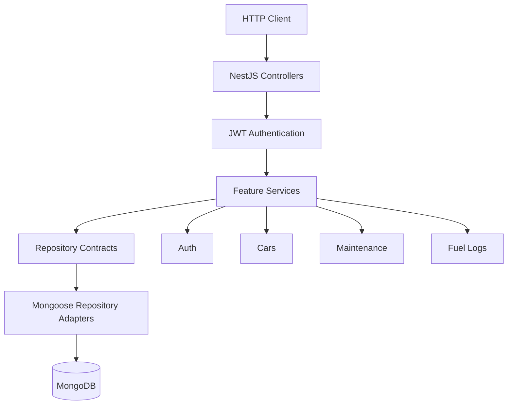

# Car Management API

A backend REST API built with **NestJS**, **TypeScript**, and **MongoDB** for managing vehicles and their maintenance and fuel records. It includes JWT authentication, user-scoped resource access, DTO validation, and a repository-based persistence layer.

## Features

- **Authentication:** User registration, login, and JWT-protected profile access.
- **Vehicle management:** Create, read, update, delete, and filter a user's cars.
- **Maintenance tracking:** Store and manage maintenance records for each vehicle.
- **Fuel tracking:** Record fuel purchases and readings for each vehicle.
- **Ownership enforcement:** Users can access only their own cars and related records.
- **Input validation:** Validate request DTOs and reject invalid identifiers and payloads.
- **Repository pattern:** Keep application services independent of Mongoose-specific persistence.
- **Automated tests:** Unit and end-to-end test suites powered by Vitest.

## Tech Stack

| Area | Technologies |
| --- | --- |
| Framework | NestJS 12 |
| Language | TypeScript |
| Database | MongoDB |
| ODM | Mongoose 9 |
| Authentication | Passport JWT, JSON Web Tokens |
| Validation | class-validator, class-transformer |
| Password hashing | bcrypt |
| Testing | Vitest, Supertest |
| Code quality | Oxlint |

## Architecture

The application follows a modular NestJS structure. Feature services depend on repository contracts, while Mongoose repository adapters handle database persistence.



## Requirements

- **Node.js 20.19.0 or later**
- npm
- MongoDB (local instance or connection URI)

> Mongoose 9 requires Node.js 20.19.0 or later. See the [official Mongoose migration guide](https://mongoosejs.com/docs/migrating_to_9.html#version-requirements).

## Getting Started

### 1. Clone the repository

```bash
git clone https://github.com/tahaessam/car-managment-api.git
cd car-managment-api
```

### 2. Install dependencies

```bash
npm install
```

### 3. Configure environment variables

Copy the example environment file and update its values:

```bash
cp .env.example .env
```

On Windows PowerShell:

```powershell
Copy-Item .env.example .env
```

Set `MONGODB_URI`, `JWT_SECRET`, and optionally `PORT` in `.env`. Use a long, random JWT secret and never commit the real `.env` file.

| Variable | Required | Description |
| --- | --- | --- |
| `MONGODB_URI` | Yes | MongoDB connection string |
| `JWT_SECRET` | Yes | Secret used to sign JWTs |
| `PORT` | No | Server port (defaults to `3000`) |

### 4. Run the application

Development mode:

```bash
npm run start:dev
```

The API is available at `http://localhost:3000` by default.

## API Overview

Protected endpoints require a bearer token:

```http
Authorization: Bearer <access_token>
```

### Authentication

| Method | Endpoint | Auth | Description |
| --- | --- | --- | --- |
| `POST` | `/auth/register` | No | Register a user |
| `POST` | `/auth/login` | No | Log in and receive an access token |
| `GET` | `/auth/profile` | Yes | Get the authenticated user's profile |

Registration example:

```json
{
  "email": "driver@example.com",
  "password": "password123",
  "username": "driver"
}
```

Passwords are hashed before storage and excluded from user responses. The login response returns an `access_token` inside `data`; tokens expire after one hour.

### Cars

All car endpoints require authentication. The owner is derived from the authenticated user and must not be supplied in the request body.

| Method | Endpoint | Description |
| --- | --- | --- |
| `GET` | `/cars` | List the authenticated user's cars |
| `GET` | `/cars?brand=Toyota` | Filter cars by exact, case-insensitive brand |
| `GET` | `/cars/:id` | Get an owned car |
| `POST` | `/cars` | Create a car |
| `PATCH` | `/cars/:id` | Update a car |
| `DELETE` | `/cars/:id` | Delete a car |

Create-car example:

```json
{
  "brand": "Toyota",
  "model": "Corolla",
  "year": 2024,
  "PlateNum": "ABC-1234"
}
```

The `year` must be an integer between 1886 and 2100. Updates accept a non-empty subset of the car fields.

### Maintenance

Each maintenance record belongs to a car. The API obtains the car ID from the route and verifies that the car belongs to the authenticated user.

| Method | Endpoint | Description |
| --- | --- | --- |
| `POST` | `/cars/:carId/maintenance` | Add a maintenance record |
| `GET` | `/cars/:carId/maintenance` | List a car's maintenance records |
| `GET` | `/maintenance/:id` | Get a maintenance record |
| `PATCH` | `/maintenance/:id` | Update a maintenance record |
| `DELETE` | `/maintenance/:id` | Delete a maintenance record |

Example request body:

```json
{
  "type": "Oil Change",
  "description": "Changed engine oil and filter",
  "date": "2025-01-15",
  "odometer": 45000,
  "laborCost": 65,
  "partsCost": 42.5,
  "notes": "Synthetic oil"
}
```

The required fields are `type`, `description`, `date`, and `odometer`. Costs are optional, non-negative numbers that default to zero; `notes` is optional.

### Fuel Logs

Each fuel log is associated with a car. The API verifies car ownership before creating, listing, reading, updating, or deleting fuel logs.

| Method | Endpoint | Description |
| --- | --- | --- |
| `POST` | `/cars/:carId/fuel-logs` | Add a fuel log |
| `GET` | `/cars/:carId/fuel-logs` | List a car's fuel logs |
| `GET` | `/fuel-logs/:id` | Get a fuel log |
| `PATCH` | `/fuel-logs/:id` | Update a fuel log |
| `DELETE` | `/fuel-logs/:id` | Delete a fuel log |

Example request body:

```json
{
  "isFullTank": true,
  "fuelAmount": 40,
  "totalCost": 60,
  "fuelPriceAmount": 1.5,
  "odometerReading": 45000
}
```

All fields shown are required. `isFullTank` must be a boolean; the numeric values must be non-negative. Updates accept a non-empty subset of these fields.

## Authorization and Error Handling

- Car operations are scoped to the authenticated user.
- Maintenance and fuel-log access is checked through the associated car.
- Missing or unowned resources return `404 Not Found`.
- Invalid request data or IDs return `400 Bad Request`.
- Missing or invalid JWTs return `401 Unauthorized`.
- Duplicate registration email returns `409 Conflict`.
- Unknown request-body fields are removed by the global validation pipe.

## API Documentation

The repository includes an OpenAPI 3.0 specification at [`openapi.yaml`](./openapi.yaml). You can import it into [Swagger Editor](https://editor.swagger.io/) to browse the endpoints, request schemas, and JWT bearer security scheme. The specification is maintained as a standalone contract; a Swagger UI endpoint is not currently hosted by this application.

## Continuous Integration

GitHub Actions runs dependency installation, build, lint, unit tests with coverage, and end-to-end tests for pull requests and pushes to `master`. See [the CI workflow](./.github/workflows/ci.yml).

## Testing

Run the available test suites:

```bash
# Unit tests
npm test

# Unit tests with coverage report
npm run test:cov

# End-to-end tests
npm run test:e2e

# Build
npm run build

# Lint
npm run lint
```

## Postman Collection

Import [`cars.postman_collection.json`](./cars.postman_collection.json) into Postman.

The collection uses a `baseUrl` variable (default: `http://localhost:3000`) and stores the login token in the collection-level `token` variable. It contains Auth, Cars, Maintenance, and Fuel Logs folders.

Run Login before protected requests. Create a car before running its maintenance or fuel-log requests.

## Available Scripts

| Command | Description |
| --- | --- |
| `npm run start:dev` | Start the app in watch mode |
| `npm run build` | Build the application |
| `npm test` | Run unit tests |
| `npm run test:cov` | Run unit tests and generate coverage report |
| `npm run test:e2e` | Run end-to-end tests |
| `npm run lint` | Lint source and test files |
